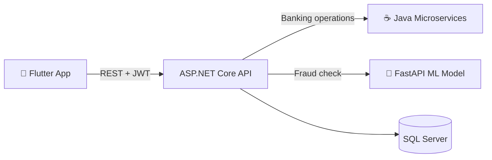

<!-- ========================= HEADER ========================= -->
<div align="center">


<a href="https://github.com/zienab-amr">
  
</a>

<br/>


<a href="https://www.linkedin.com/in/zeinabamr/"></a>
<a href="mailto:zienabamr2372005@gmail.com"></a>
<a href="https://github.com/zienab-amr"></a>

</div>

---

## 👩‍💻 About Me

```csharp
public class ZeinabAmr : Developer
{
    public string Role       => ".NET Backend Developer";
    public string University => "Ain Shams University – Computer Science (Class of 2027)";
    public string[] Stack    => ["ASP.NET Core", "SQL Server", "Flutter", "Node.js", "Angular"];
    public string Focus      => "Secure APIs, RBAC, Microservices & clean architecture";
    public bool OpenToWork   => true; // Junior .NET Developer roles
}
```

- 🔐 I build **secure authentication flows** (JWT, Refresh Tokens, OTP) and **database-driven RBAC** systems.
- 🧩 I enjoy connecting different technologies: **.NET + Java microservices + ML models + Flutter** in a single system.
- 🏆 Winner of **Best Software Engineering Project** (CLS Company – DEPI) and **1st place** in the NTI training program.
- 🌱 Currently deepening my skills in **Angular** and the **MEAN stack**, while looking for my first **Junior .NET Developer** role.

---

## 🛠️ Tech Stack

<div align="center">

**Backend**


**Mobile & Frontend**


**Databases & Tools**


</div>

**Concepts:** Layered Architecture • Microservices • Repository Pattern • JWT & Refresh Tokens • OTP Authentication • RBAC • Middleware Authorization • BLoC/Cubit

---

## 📂 Featured Projects

| Project | Stack | Highlights |
|---|---|---|
| 💳 **ShadowPay** | Flutter • ASP.NET Core • Java • FastAPI • SQL Server | Smart payment & real-time fraud detection |
| 🏢 **OPTIMA ERP** 🏆 | ASP.NET MVC • SQL Server • AJAX | Dynamic DB-driven RBAC — *Best Project Award* |
| 🏦 **Banking System** | Flutter • Java JAX-RS • JPA/Hibernate | Layered REST backend with secure transactions |
| 🔄 **SyncSkill** | Flutter • Firebase • Firestore • BLoC | Peer-to-peer skill exchange platform |
| 🏗️ **AssetLink** 🥇 | Angular • Node.js • Express • MongoDB | B2B equipment rental — *1st place at NTI* |

<br/>

<details open>
<summary><b>💳 ShadowPay – Smart Payment & Fraud Detection System</b> &nbsp;<sub>(Mar – May 2026)</sub></summary>

<br/>

`Flutter` `ASP.NET Core Web API` `Java Microservices` `FastAPI` `SQL Server` `JWT`

- **Solely engineered the ASP.NET Core backend** with a robust auth flow: JWT, refresh tokens, and a 5-minute Memory Cache OTP system.
- **Orchestrated cross-service integration** between the .NET API, Java banking microservices, and a FastAPI ML model for real-time fraud validation.
- **Built the Flutter integration layer** using Dio, BLoC/Cubit, and `flutter_secure_storage`.



</details>

<details>
<summary><b>🏢 ERP System – OPTIMA</b> 🏆 &nbsp;<sub>(Aug – Dec 2025)</sub></summary>

<br/>

`ASP.NET MVC` `SQL Server` `Bootstrap` `JavaScript` `AJAX`

- **Architected a fully dynamic, database-driven RBAC system** with custom middleware enforcing action-level authorization — no hardcoded permissions.
- **Built a responsive, mobile-first UI** with adaptive data cards, dynamic sidebars, and a UI-driven permission management engine.
- 🏆 Awarded **"Best Software Engineering Project"** at CLS Company (DEPI).

</details>

<details>
<summary><b>🏦 Full Stack Banking System</b> &nbsp;<sub>(Apr – May 2026)</sub></summary>

<br/>

`Flutter` `Java JAX-RS` `JPA/Hibernate` `SQL`

- **Architected a layered Java REST backend** (Resource → Service → Repository) with optimized JPQL queries and pagination.
- **Built secure banking modules** for accounts and transactions, including CVV hashing and dynamic card masking.
- **Integrated the Flutter mobile app** with the Java APIs and external payment gateways.

</details>

<details>
<summary><b>🔄 SyncSkill – Skill Exchange Platform</b> &nbsp;<sub>(Jul – Aug 2026)</sub></summary>

<br/>

`Flutter` `Firebase` `Cloud Firestore` `BLoC/Cubit`

- Built a peer-to-peer platform with a full **request lifecycle** (send, accept, reject, cancel, track) and user-specific data access.
- Implemented **real-time UI sync** with BLoC/Cubit for requests and notifications.

</details>

<details>
<summary><b>🏗️ AssetLink – Enterprise Equipment & Asset Rental Platform</b> 🥇 &nbsp;<sub>(Jul – Aug 2026)</sub></summary>

<br/>

`Angular` `Node.js` `Express.js` `MongoDB`

- **Led the team to 1st place** in the NTI training program: system architecture, task delegation, and Git workflow.
- Engineered a **B2B rental platform** with digital contracts, escrow, and real-time negotiation.

</details>

---

## 🎓 Education, Courses & Awards

| | |
|---|---|
| 🎓 **B.Sc. Computer Science** | Faculty of Science, Ain Shams University — Expected 2027 |
| 🏆 **Best Software Engineering Project** | CLS Company (DEPI Initiative) |
| 🥇 **1st Place — AssetLink** | NTI Training Program |
| 📚 **.NET Development Certificate** | Information Technology Institute (ITI) — 2026 |
| 📚 **MEAN Stack Development** | National Telecommunication Institute (NTI) — Final Score **97.5%** |
| 📚 **Flutter Cross-Platform** | Information Technology Institute (ITI) — 2026 |
| 📚 **Full Stack .NET Track** | Digital Egypt Builders Initiative (DEPI) — 2025 |
| 📚 **CS50: Intro to Computer Science** | Information Technology Institute (ITI) — 2024 |

---

## 📊 GitHub Stats

<div align="center">


</div>

---

## 🤝 Let's Connect

<div align="center">

I'm actively looking for a **Junior .NET Developer** opportunity — feel free to reach out! 💜

<a href="https://www.linkedin.com/in/zienab-amr-709367300/"></a>
<a href="mailto:zienabamr2372005@gmail.com"></a>


</div>
